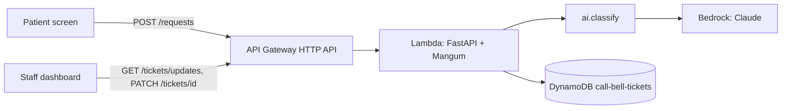

# Design Document

## Overview

Two static React frontends (patient screen, staff dashboard) talk to one FastAPI backend running on AWS Lambda behind an
API Gateway HTTP API. The backend calls a classifier module that uses Claude on Amazon Bedrock, validates its JSON output,
applies safety rules, and stores tickets in DynamoDB. The dashboard polls for changes every 2 seconds.
Full picture: `docs/architecture.md`.

## Architecture

## Components and Interfaces

### Backend (`backend/app`)
- `main.py` – FastAPI app, CORS, routes, Lambda `handler` (Mangum).
- `models.py` – Pydantic models mirroring `shared/ticket.schema.json`.
- `store.py` (Phase 1) – `TicketStore` interface with `InMemoryStore` (local/tests) and `DynamoStore` (AWS), chosen by env var.
- `routing.py` (Phase 1) – category → department map and the safety fallback.

### Classifier (`ai/`)
- `classify(text: str, language: str | None) -> Classification` – the only function the backend calls.
- Builds the system prompt (categories, urgency rules, JSON-only output), calls Bedrock with a timeout (target 5 s),
  parses and validates the JSON, and raises/returns the fallback on any failure.

### Evaluation (`eval/`)
- `test_set.csv` – id, text, language, expected_category, expected_priority, note.
- `score.py` – runs every row through `classify`, prints accuracy, a confusion table, and **missed urgent count**.

### Frontends (`frontend/patient`, `frontend/dashboard`)
- Patient: text box, Send, quick buttons, confirmation and error states; room from `?room=` URL param.
- Dashboard: tabs per department + nurse view, ticket cards, status buttons, poller, alert banner + sound.

## Data Models

Ticket – see `shared/ticket.schema.json`. DynamoDB table `call-bell-tickets`:

| Attribute | Type | Notes |
| --- | --- | --- |
| `ticket_id` (PK) | S | `t_` + short random id |
| `department` | S | GSI `department-created_at` for queue queries |
| `created_at` | S | ISO 8601, GSI sort key |
| `updated_at` | S | used by `/tickets/updates?since=` |
| other ticket fields | | as in the schema |

## Error Handling

| Failure | Behaviour |
| --- | --- |
| Bedrock timeout / throttling / access error | Fallback ticket: `unclear` → `nurse`, `high`; reason "classifier unavailable" |
| Invalid or schema-violating JSON | Same fallback; log the failure type (not the text) |
| Confidence below threshold | Same fallback; keep the model's suggested category in `reason` |
| DynamoDB write failure | Return 503 to the patient screen, which shows the "Call nurse" fallback |
| Bad client input | 422 with `detail` |

## Testing Strategy

- Backend: pytest with FastAPI `TestClient` and `InMemoryStore`; contract tests check responses against the schema.
- Classifier: unit tests with a stubbed Bedrock client for fallback paths; live runs via `eval/score.py`.
- Safety target: 0 missed urgent cases and ≥ 90% overall accuracy on ≥ 50 test phrases before Phase 4.
- End-to-end: scripted demo run (pillow → housekeeping; chest pain → nurse alert) before every rehearsal.
