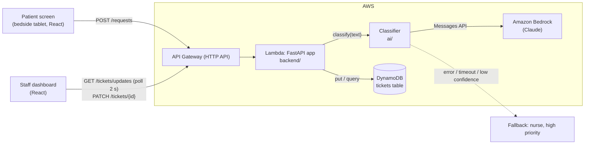

# Architecture (one page)

Owner: Chaitya. Status: agreed for Phase 0–1; revisit only via [`decisions.md`](decisions.md).

## Components

| Component | Tech | Why | Owner |
| --- | --- | --- | --- |
| Patient screen | React + Vite, static files | Fast to build, runs in any tablet browser | Harsh |
| Staff dashboard | React + Vite, static files | Same stack as the patient screen, shared components | Om |
| Hosting (frontends) | AWS Amplify Hosting or S3 static site | One-click deploy from the repo | Chaitya |
| API | FastAPI (Python) on AWS Lambda via Mangum, behind API Gateway HTTP API | Same code runs locally (`uvicorn`) and on Lambda; auto docs at `/docs` | Chaitya |
| Classifier | Python module in `ai/`, called by the API | Python is shared with the eval scripts | Chaitanya |
| LLM | Claude on Amazon Bedrock (`anthropic` SDK, `AnthropicBedrockMantle` client) | Available through our Workshop Studio AWS account | Chaitanya |
| Ticket store | DynamoDB table `call-bell-tickets` (on-demand) | No servers, free tier, simple key lookups | Chaitya |
| Live updates | Dashboard polls `GET /tickets/updates` every 2 s | Simplest thing that demos well; WebSockets are a stretch goal | Chaitya / Om |
| Infra as code | AWS SAM (`backend/template.yaml`) | One command to deploy API + Lambda + table | Chaitya |

## Request flow

1. Patient taps a quick button or types a request; the patient screen sends `POST /requests`.
2. The API calls `classify(text)`. The classifier asks Claude on Bedrock for JSON matching
   [`shared/ticket.schema.json`](../shared/ticket.schema.json) and validates it.
3. **Safety fallback:** timeout (target 5 s), invalid JSON, or confidence below the agreed threshold →
   `department: nurse`, `priority: high`. The request is never dropped.
4. The API stores the ticket in DynamoDB and returns it. The patient sees the confirmation.
5. The dashboard polls for updates; the department queue (or the nurse alert) shows the new ticket.
6. Staff press Acknowledge / Done → `PATCH /tickets/{id}`.

## Data and security

- Synthetic data only; no PHI anywhere (prompts, logs, test sets, screenshots).
- Secrets live in `.env` locally and in Lambda environment variables / IAM roles in AWS, never in git.
- The Lambda's IAM role gets only the permissions it needs (DynamoDB table access; Bedrock invoke added in Phase 1).
- CORS is limited to our frontend origins.

## Non-goals for the hackathon

Real EHR / nurse-call system integration, authentication for staff, HIPAA-grade hosting. We mention these in the pitch as next steps.

## Region

`us-east-1` unless the Workshop Studio account says otherwise. Everyone uses the same region.
